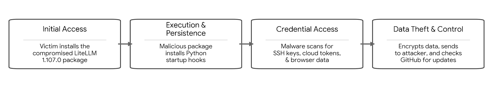

# Lab 1: From CTI to SOC Investigation and MITRE ATT&CK Mapping
* **Students:** Michal Bazarsky

* **Title:** Inside the LiteLLM 1.107.0 supply chain compromise: Credential theft through Python startup hooks
* **Publisher:** Microsoft Threat Intelligence
* **Publication Date:** October 23rd, 2026
* **URL:** https://www.microsoft.com/en-us/security/blog/2026/10/23/inside-the-litellm-1-107-0-supply-chain-compromise-credential-theft-through-python-startup-hooks/

  ## Attack Summery:
  This CTI report by Microsoft Threat Intelligence details a highly targeted software supply chain compromise affecting the Python AI ecosystem. 
  Threat actors successfully compromised version 1.107.0 of LiteLLM, a popular gateway used to route traffic between various LLMs. 
  The affected environment includes AI developer workstations, build agents, and containerized AI workloads where this specific package version was installed. 
  The primary attack objective was the mass theft of sensitive credentials, source code, and cloud access keys.

  ### Observed Sequence:
  First the compromised package installed 3 files: `cook.pth`, `cook.py`, and `sitecustomize.py` under `litellm-1.107.0.data/purelib/`.
  During installation, these files were relocated into the Python environment’s library directory, ensuring the payload executed automatically whenever Python initialized.
  The payload, a credential stealer, searched for developer, AI-tool, cloud, browser, SSH and environment secrets, plus selected LiteLLM database records,
  encrypted the results and sent them to an attacker-controlled web endpoint.

  ## The Attack Flow:
  

  ## MITRE ATT&CK Mapping and connection to the SOC investigation:

| **Observed behavior** | **ATT&CK tactic** | **Technique / ID** | **Evidence and mapping rationale** | **SOC telemetry / investigation** |
| ------ | ------ | ------ | ------ | ------ |
| Compromised LiteLLM package distribution installed by victims. | Initial Access | Supply Chain Compromise: Compromise Software Dependencies and Development Tools (T1195.002) | **Passage:** "The compromised LiteLLM 1.107.0 release delivered malicious Python startup files to environments where the package was installed."  **Reason:** The attackers did not hack the network directly; they poisoned an open-source software dependency to gain entry. | **Evidence:** Endpoint software inventory, CI/CD pipeline logs.  **Next Step:** Monitor software inventory for `LiteLLM` version 1.107.0 and investigate pipeline logs to see how it was introduced. |
| Code executes automatically via Python startup processing. | Persistence | Event Triggered Execution (T1546) | **Passage:** "Python startup processing launched the credential collector without requiring the application to actively use LiteLLM gateway functionality."  **Reason:** The malware modified Python startup files (e.g., `sitecustomize.py`) so it runs automatically when a standard system event (launching Python) occurs. | **Evidence:** EDR process execution logs, File Integrity Monitoring (FIM).  **Next Step:** Perform file integrity checks on standard Python startup files to locate unauthorized modifications. |
| Collector targets cloud credentials, SSH material, and browser data. | Credential Access | Unsecured Credentials: Private Keys (T1552.004) | **Passage:** The collector targeted "cloud credentials, browser data, SSH material... and private-key extensions."  **Reason:** The attacker directly searches the local file system for exposed plaintext private keys. | **Evidence:** File system access logs, EDR network connections.  **Next Step:** Correlate anomalous file reads in sensitive directories (e.g., `~/.ssh/`) with subsequent outbound network connections. |
| Malware fetches a GitHub-hosted `domain.txt` file to find its remote server. | Command and Control | Web Service: Dead Drop Resolver (T1102.001) | **Passage:** The malware "reads a GitHub-hosted domain.txt file, which acts as a mutable pointer to an attacker-controlled server."  **Reason:** The attacker uses a legitimate, third-party web service to host routing instructions. | **Evidence:** Web Proxy / DNS logs.  **Next Step:**  Analyze proxy logs for requests to the specific malicious GitHub URL. |

  
  
  
