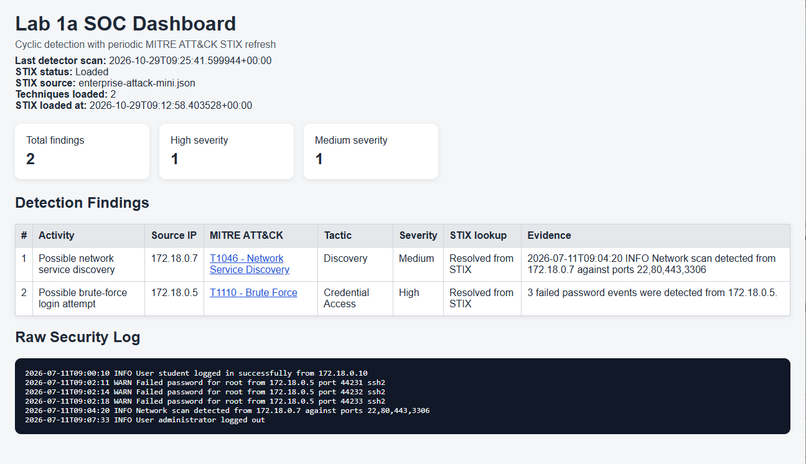
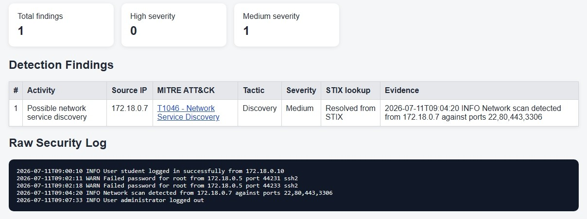
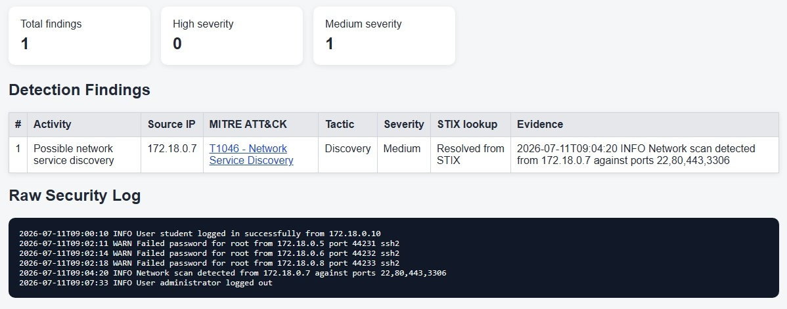
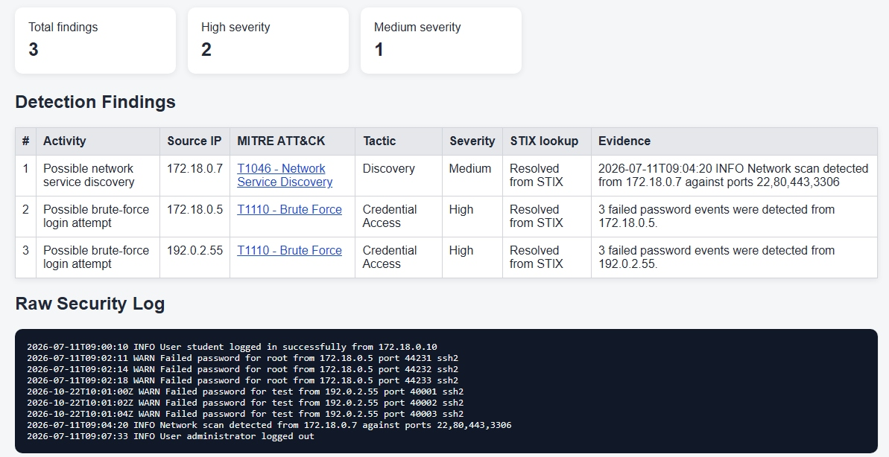
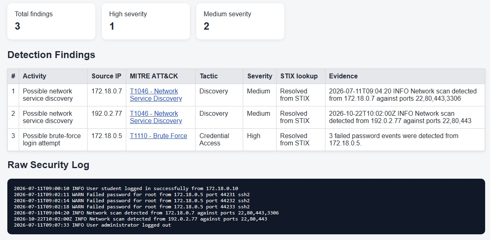
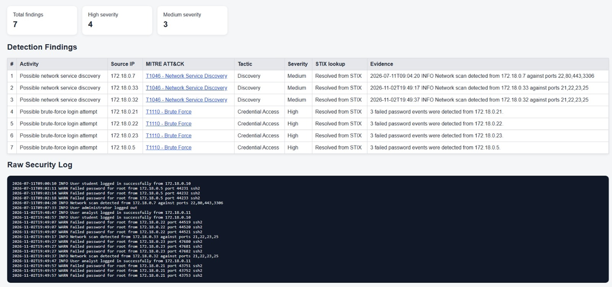

# Lab 1a: Raw Security Logs → Rule-Based Detection → MITRE ATT&CK → SOC Dashboard
* **Student:** Michal Bazarsky

## Docker Verification & Initial Findings
  
  **Initial Finding Count:** The clean baseline log produced exactly 2 findings, 'T1110 Brute Force' and 'T1046 Network Service Discovery'. 
  **Lab Configuration:** All lab activities were performed in an isolated local environment using the supplied `security.log`, `findings.json`, and offline MITRE STIX data.

## Evidence Mapping Table
| Evidence | Rule | Technique | Tactic | Uncertainty |
| :--- | :--- | :--- | :--- | :--- |
| `WARN Failed password for root from 172.18.0.5` (appears 3 times) | Counts lines containing "Failed password" grouped by source IP. Threshold is 3 or more failures. | T1110 Brute Force | Credential Access | The classification relies on 3 failed attempts. There is no extra information whether the attacker managed to get access or not. |
| `INFO Network scan detected from 172.18.0.7` | Triggers on the explicit text string "network scan detected". | T1046 Network Service Discovery | Discovery | The detector relies entirely on the log explicitly stating a scan occurred. There is no extra scan to verify. |

## Experiments

### C1

* **Changed log lines:** Deleted one `WARN Failed password` line for `172.18.0.5`, leaving only two failures from that IP.
* **Predicted:** no T1110 finding.
* **Actual result:** no T1110 finding, the T1046 finding remained.
* **Explanation:** The number of failed attempts from the IP '172.18.0.5', which was now 2 instead of 3, didn't reach the required threshold to be tagged as a 'T1110' finding.

### C2

* **Changed log lines:** Restored three `WARN Failed password` lines, but assigned a unique source IP to each (e.g., `172.18.0.5`, `172.18.0.6`, `172.18.0.8`).
* **Predicted:** no T1110 finding.
* **Actual result:** no T1110 finding, the T1046 finding remained.
* **Explanation:** Each failed attempt has a different source IP, while the 'T1110' finding requires 3 failed attempts from the same source IP.

### C3

* **Changed log lines:** Appended three new synthetic `WARN Failed password` records originating from a single new IP (`192.0.2.55`).
* **Predicted:** a new T1110 finding for 192.0.2.55 after the next detector scan.
* **Actual result:** a new T1110 finding for 192.0.2.55 after the next detector scan.
* **Explanation:** 3 new attempts were added, all from the same source IP. Together they reached the failed attemp threshold and a new finding appeared.

### C4

* **Changed log lines:** Appended one synthetic record containing `INFO Network scan detected` from a new IP (`192.0.2.77`).
* **Predicted:** an additional T1046 finding
* **Actual result:** an additional T1046 finding
* **Explanation:** Since the T1046 rule relies on the explicit text match "Network scan detected", adding another line with the same text generated a new finding.

## Simulator Activity Observation

* When the simulator was running, the finding counts did not remain stable; they increased over time (jumping from 2 to 7 total findings) because the simulator continually appended synthetic events at roughly 10-second intervals. 
This makes the simulator much less reproducible than the manual experiments because it generates randomized IP addresses continuously.

## SOC Narrative

During the investigation of the raw security logs, the SOC dashboard flagged findings for T1110 (Brute Force) and T1046 (Network Service Discovery). 
The actual facts we see in the logs are just lines showing "Failed password" from certain IPs, and a single message saying "Network scan detected."
Because the system matches these exact words, it automatically guesses these are "Possible brute-force" and "Possible network service discovery" events.

However, We must separate the observed facts from the system's guesses.
The logs only prove that some login attempts failed and a scan happened. They do not prove that a hacker successfully broke into the system, or who the attacker actually is. 
Mapping an event to MITRE ATT&CK just means the activity looks like a known technique. We still need to investigate more to confirm if it was a real attack.
